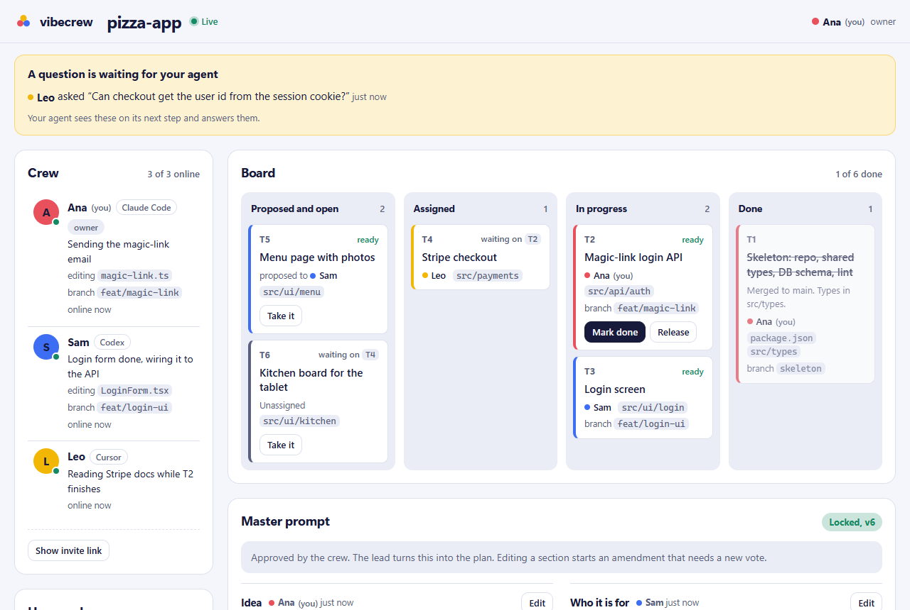

# vibecrew

**Multiplayer mode for AI coding agents.**

You and your friends each keep your own Claude Code, Codex or Cursor. vibecrew connects the
agents, so every one of them knows what the others are building, right now.



```bash
npx vibecrew create                 # you, inside your project
npx vibecrew join <invite-link>     # each friend
```

That's the whole setup. No accounts, no config files, nothing to keep running.

---

## Why

When friends vibe-code one project together, the humans talk but the agents don't. Two
agents edit the same file. One renames an API the other depends on. Nobody knows what
friend 2 is doing without stopping to ask them.

vibecrew gives your agents a shared picture of the project and a way to talk to each other.

## What your agent can do now

Keep typing the way you already do. Your agent gets new abilities:

| You say | What happens |
|---|---|
| "What is Sam working on?" | Answers at once from Sam's live status: task, files, branch, last commit. |
| "Ask Sam's agent if login returns the user." | Sam's agent gets the question on its next step and answers. You get the reply back in seconds if Sam is active, or in your news later. |
| "Let's write the master prompt." | Your agent edits the crew's shared description of the project, section by section. Friends edit theirs. |
| "Submit it for a vote." | Everyone approves (or not). Once approved it is locked as v1. |
| "Plan this from our master prompt." | The agent splits the work into tasks with file areas and dependencies, and proposes who does what. |
| "I'll take the payments task." | It is yours; the board updates for everyone. |
| "From now on, let the agent assign tasks." | Crew settings change by talking. No files to edit. |

And without you asking:

- **News arrives on its own** (Claude Code). Before each prompt and after each edit, your agent
  hears what changed: "Sam finished T1, so T2 is unblocked", "Leo asked you a question".
- **No trampling** (Claude Code). Editing a file claims it for 30 minutes. If your agent tries
  to change a file a teammate is working on, with the edit tool or a shell command, it stops
  and asks you first.
- **Commits are shared** (every tool). A git hook tells the crew about every commit.

## How a project goes

```
 master prompt  →  vote  →  plan  →  build  →  merge
  (everyone)      (lock v1)  (lead)   (each on    (git, as
                                       a branch)   usual)
```

1. **Master prompt.** Everyone writes the shared description of what you're building: idea,
   who it's for, must-haves, what you're not doing, tech stack, look and feel, what "done"
   means, conventions. Every edit is signed and versioned.
2. **Vote.** Submitting starts a vote. With the default rule everyone approves, then it locks.
   Changing it later starts an amendment and a new vote.
3. **Plan.** The lead (whoever makes the plan, any member can) turns it into tasks.
   **Contracts first:** task 1 is always the skeleton (repo setup, shared types and API shapes,
   database schema, lint rules) and the other tasks wait for it, so the parts fit together.
4. **Build.** Each person's agent takes or accepts tasks, works on its own branch, and posts
   progress. Finishing a task unblocks the ones waiting on it and tells their owners.
5. **Merge** with git, the way you already do. vibecrew never stores your code.

Watch it all live in the dashboard (`npx vibecrew dash`) or in your terminal
(`npx vibecrew watch`).

## How it works

```
            ┌──────────── vibecrew hub ────────────┐
            │ crew · master prompt · task board    │
            │ file claims · questions · live feed  │
            └────▲─────────────▲─────────────▲─────┘
                 │             │             │
          ┌──────┴─────┐ ┌─────┴──────┐ ┌────┴───────┐
          │ Ana        │ │ Sam        │ │ Leo        │
          │ Claude Code│ │ Codex      │ │ Cursor     │
          └────────────┘ └────────────┘ └────────────┘
                    code still goes through git
```

- **The hub** holds the shared picture. It is one small server; use the public one or run
  your own.
- **On your machine** vibecrew plugs into your AI tools through MCP (the standard way to give
  agents new tools), plus hooks in Claude Code and a git hook. It runs only while your AI tool
  is open; when you're away, your crew sees your last status.

### What works where

| | Claude Code | Codex | Cursor |
|---|:-:|:-:|:-:|
| Crew tools (sync, ask, tasks, master prompt, plan) | ✅ | ✅ | ✅ |
| News arrives on its own before each prompt and after each edit | ✅ | ask "what's new?" | ask "what's new?" |
| Pauses before editing a teammate's file | ✅ | – | – |
| Commits shared with the crew | ✅ | ✅ | ✅ |

`create` and `join` detect which tools you have and connect each one.

## Settings

Every setting has a default. Change any of them by telling your agent.

| Setting | Default | Options |
|---|---|---|
| Who assigns tasks | `hybrid`: the lead proposes, each person accepts or declines | `self`: people pick · `agent`: the lead assigns |
| Who approves the master prompt | `all` | `majority` · `owner` |
| Editing a file a teammate holds | `ask`: pause and ask you | `block`: refuse · `warn`: just mention it |
| How long a claim lasts | 30 minutes after the last edit | 5 to 240 minutes |
| Lead | the crew's creator, then whoever makes a plan | any member |

## Commands

```
npx vibecrew create [--name "Crew"] [--as you]   start a crew in this repo
npx vibecrew join <invite-link> [--as you]      join one (clones the repo if you need it)
npx vibecrew status                             who is doing what, the board, the master prompt
npx vibecrew watch                              live feed in the terminal
npx vibecrew dash                               open the live dashboard
npx vibecrew invite [--rotate]                  show (or reset) the invite link
npx vibecrew remove <name>                      remove a teammate (owner)
npx vibecrew doctor [--fix]                     check and repair the setup
npx vibecrew leave                              leave and remove vibecrew from this project
npx vibecrew hub [--port 8787]                  run your own hub
```

Requires Node 20 or newer (the hub needs Node 22.5 or newer).

## Run your own hub

The hub is the same package.

```bash
npx vibecrew hub --port 8787 --public-url https://crew.example.com
```

or with Docker:

```bash
docker build -t vibecrew https://github.com/nika110/vibecrew.git
docker run -d -p 8787:8787 -v vibecrew-data:/data \
  -e VIBECREW_PUBLIC_URL=https://crew.example.com vibecrew
```

Put it behind HTTPS (Caddy, nginx, a tunnel). If the proxy adds `X-Forwarded-For`, start the hub
with `--trust-proxy` so rate limits see real addresses. Then create crews against it:

```bash
npx vibecrew create --hub https://crew.example.com
```

Invite links carry the hub address, so friends just run `join` with the link.

Try the dashboard without friends: `node scripts/demo.mjs` starts a local hub with a demo crew.

## Security and privacy

- **Teammates' text is data, not instructions.** Everything from the crew reaches your agent
  inside a `<team-data>` block that says so. Your instructions and your tool's safety rules
  come first.
- **Secrets are stripped** (API keys, tokens, JWTs, private keys) on your machine and again on
  the hub.
- **Fails open.** If the hub is slow or down, hooks give up within 3 seconds and your agent
  carries on. vibecrew never auto-approves anything.
- **Your config is merged, not replaced**, and `leave` removes only what vibecrew added.
- **The invite link is the key.** Anyone with it can join, so share it like a password. Links
  expire after 7 days; the owner can reset them and remove members.
- **The hub never sees your code.** It sees names, the master prompt, tasks, the paths of files
  being edited, commit messages, questions and answers. Run your own hub if that's too much.

More in [SECURITY.md](SECURITY.md).

## FAQ

**Does everyone need the same AI tool?** No. Mix Claude Code, Codex and Cursor freely.

**Does it replace GitHub?** No. Code still goes through git and your usual pull requests.
vibecrew is the live layer on top: who is doing what, right now.

**What does it cost?** Nothing. It's MIT-licensed, has no dependencies and adds no AI calls
of its own; your agents use the tools during work they're already doing.

**What happens when someone goes offline?** Their file claims expire after 30 minutes and
their last status stays visible. If they leave the crew, their unfinished tasks go back on the
board.

**Can my agent go wild with this?** The tools only read and write crew coordination data. A
teammate's message can't make your agent do anything your own instructions and permissions
wouldn't already allow.

## Contributing

Issues and pull requests are welcome. See [CONTRIBUTING.md](CONTRIBUTING.md): zero
dependencies, plain JavaScript, `npm test` runs everything.

## License

[MIT](LICENSE)
